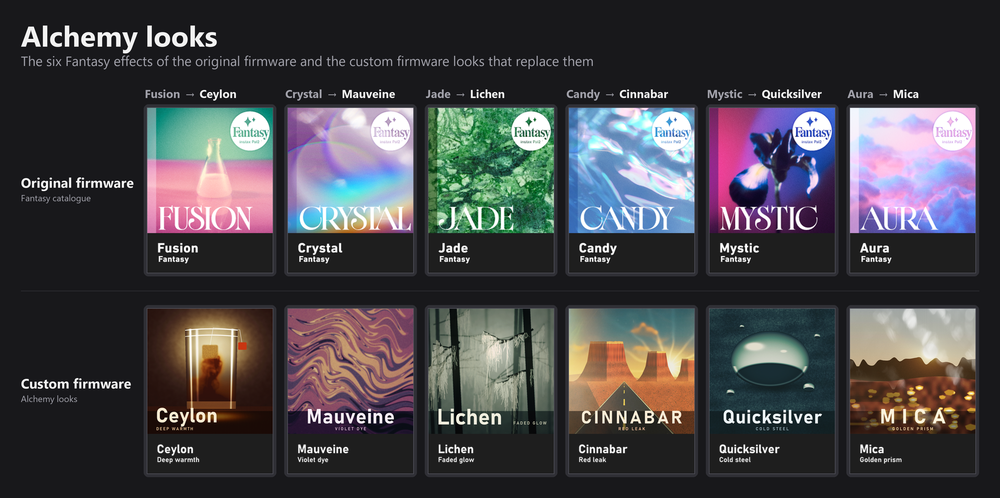
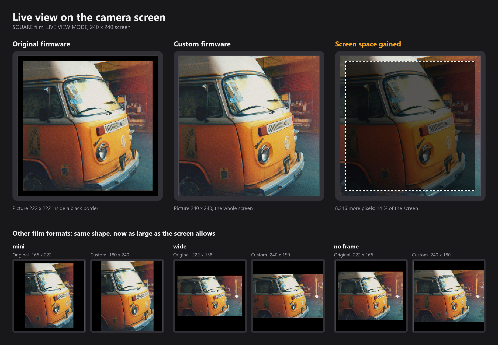
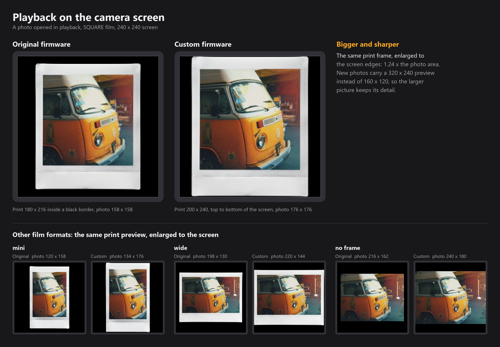

# instax Pal 2 Custom Firmware

**Version 1.1**

Custom firmware for the instax Pal 2: twelve film looks, sharp film grain, film halation, a film-style tone curve, steadier
auto exposure, film-camera sounds, an infinity focus mode and a redesigned interface in seven colour palettes.

## Disclaimer

This is unofficial firmware, not made or supported by Fujifilm. I have tested it on my own camera and made sure it works,
but installing it is entirely at your own discretion and risk: a failed or interrupted update can leave the camera unable to
start (bricked).

## How to install

You need the camera with a fully charged battery, a microSD card and a card reader.

1. **Back up your photos.** Copy anything you want to keep off the card and off the camera's internal memory.
2. **Optional: format the card in the camera.** This makes sure the camera detects the update. With the card in the camera,
   open the menu, go to the settings tab (gear icon), choose **FORMAT**, then **CARD**, and confirm. This erases the card.
3. **Download one palette.** Download the zip of the palette you want from the [palette table](#palettes) (about 113 MB)
   and unzip it. It holds four files: `SStarOta.bin.gz`, `SStarOtaLayout_ab.txt`, `OTA_VER.txt` and `downgrade.txt`
   (empty, but required).
4. **Copy them to the card.** Put the four files themselves in the root of the microSD card, not the folder they unzip
   into, and leave no other firmware files on the card. Keep the file names unchanged.
5. **Start the update.** With the camera off, insert the card and turn the camera on. Open the menu, go to the settings tab,
   choose **FIRMWARE UPGRADE** and confirm with **SET**.
6. **Wait.** The screen shows UPGRADE IN PROGRESS. Do not turn the camera off or remove the card until it has finished.
   The camera removes the update files from the card by itself.

When the update comes from the original firmware or from version 1.0, the camera may end with **"Version update error /
Battery insufficient"**, even with a full battery. Disregard it and turn the camera off: that message comes from the
firmware doing the update, which also expects a Bluetooth chip update these four files do not contain. From version 1.1 on,
a successful update ends with **THE FIRMWARE UPGRADE HAS BEEN COMPLETED**; a failed one still shows the error.

To switch palette later, repeat these steps with another zip. Version 1.0 stays available on the
[Releases](https://github.com/TheWors3/pal2-custom-firmware/releases) page.

## Palettes

Every palette has the same features. Only the interface colours, the startup screen, the film-format cards and the look
title cards differ. The top row is the original firmware.

| Palette | Colours | Download |
|---|---|---|
| Terracotta | Terracotta frame, cream lists, salmon selection, peach accents | [Terracotta.zip](https://github.com/TheWors3/pal2-custom-firmware/releases/download/v1.1/Pal2-Custom-Firmware-1.1-Terracotta.zip) |
| Darkroom | Dark mode under a safelight: warm near-black, ember-red selection and tabs, warm grey text | [Darkroom.zip](https://github.com/TheWors3/pal2-custom-firmware/releases/download/v1.1/Pal2-Custom-Firmware-1.1-Darkroom.zip) |
| Cyanotype | The blueprint process: deep Prussian blue, paper-white text, a brighter blue selection | [Cyanotype.zip](https://github.com/TheWors3/pal2-custom-firmware/releases/download/v1.1/Pal2-Custom-Firmware-1.1-Cyanotype.zip) |
| Limelight | Forest-green frame, pale lime lists, a bright lime selection with dark text | [Limelight.zip](https://github.com/TheWors3/pal2-custom-firmware/releases/download/v1.1/Pal2-Custom-Firmware-1.1-Limelight.zip) |
| Risograph | Two inks on natural paper: fluorescent pink frame, riso-blue text and selection, warm cream lists | [Risograph.zip](https://github.com/TheWors3/pal2-custom-firmware/releases/download/v1.1/Pal2-Custom-Firmware-1.1-Risograph.zip) |
| Verdigris | Weathered copper: patina-teal frame and text, copper selection and title bars, warm cream lists | [Verdigris.zip](https://github.com/TheWors3/pal2-custom-firmware/releases/download/v1.1/Pal2-Custom-Firmware-1.1-Verdigris.zip) |
| Wisteria | Wisteria in bloom: dusty purple frame, lilac lists, orchid selection, warm cream text on the frame | [Wisteria.zip](https://github.com/TheWors3/pal2-custom-firmware/releases/download/v1.1/Pal2-Custom-Firmware-1.1-Wisteria.zip) |

## Looks

Twelve looks in two groups take the place of the original Modern and Fantasy effects, slot for slot. Each has its own
colour, exposure, grain and effects, and a new name, cover and title card. The other effect catalogues are unchanged.

### Analog

| Original | New look | Character | Effects |
|---|---|---|---|
| Pure | Seaglass | Coastal fade: creative colour grade | Vignette, light flare |
| Cool | Ember | Burnt leak: warm creative grade, +1/3 EV | Light leaks at 65 %, a different leak each time the look is selected |
| Muted | Kinescope | Screen film: Fujifilm X-Tra 400 | Screen texture |
| Soft | Zenith | Midday colour: Fujifilm Velvia 100, −1/3 EV | Light flare |
| Flare | Halide | Silver mono: Kodak Vision3 250D in black and white, −1/3 EV | Vignette, crystal effect, the strongest grain |
| Mono | Limelight | Warm spotlight: Kodak Portra 400, −2/3 EV | Strong vignette, halation, light leaks at 15 % |

### Alchemy

| Original | New look | Character | Effects |
|---|---|---|---|
| Fusion | Ceylon | Deep warmth: rich reds and browns, heavy shadows, −1/3 EV | — |
| Crystal | Mauveine | Violet dye: greens turn mauve and violet, light goes peach-pink, +1/3 EV | — |
| Jade | Lichen | Faded glow: muted olive, khaki and grey-green, −1/3 EV | Strong halation, vignette |
| Candy | Cinnabar | Red leak: burnt orange-red with teal skies, −1/3 EV | The camera's ten light leaks in turn at 65 %, a faint flare |
| Mystic | Quicksilver | Cold steel: slate and steel-teal, silvered foliage, deep blue-black shadows, +1/3 EV | Light halation, light flare, vignette |
| Aura | Mica | Golden prism: golden haze and bright creams, −1/3 EV | Crystal prism reflections |

The exposure values are each look's offset; all looks and effects also start half a stop darker than the original firmware
(see [Image quality](#image-quality)).

## What's new in 1.1

- **Six Alchemy looks** in place of the Fantasy effects (above).
- **Three more palettes**: Risograph, Verdigris and Wisteria.
- **Film halation** replaces the soft glow in Limelight, Lichen and Quicksilver: a warm red-orange halo around bright
  highlights, the way light spreads back through film around a lamp, a window or a reflection. The mid-tones stay
  untouched, where the soft glow lifted the whole picture into a haze.
- **Steadier exposure**: the camera meters from the darker 60 % of the whole frame, so a window, a lamp or the sky moving
  in or out of the frame, or the subject moving off centre, no longer shifts the exposure. Night scenes meter as before,
  and with face detection on, a detected face still takes priority.
- **Cleaner daylight photos**: in daylight the sensor runs at its lowest gain instead of at four times that or more, with
  a longer shutter, so about four times more light reaches it for the same picture brightness: less noise.
- **Full sun**: the shortest shutter time is 63 µs (about 1/16000 s) instead of 150 µs, so bright sun is no longer
  over-exposed.
- **White balance in daylight**: a face, a beige wall or wood filling much of the frame no longer turns the picture
  blue. Warm indoor light keeps its warmth.
- **Tone curve**: a film toe holds detail in dark areas of high-contrast scenes instead of letting them go nearly black,
  and the bright tones roll off the way a print holds its highlights.
- **Exposure**: every look, every effect and shooting without an effect start half a stop darker, which keeps more
  highlight detail. Each EV step still moves exposure by 1/3.
- **Film grain follows the tone**, as on negative film: strongest in the shadows, lighter in the mids, light in the
  highlights.
- **Sharpening** is back on, at about a third of the original strength, with bright edge halos held lower still.
- **Live view** fills the whole screen in LIVE VIEW MODE.
- **Playback**: the print preview, frame and photo, is enlarged to fill the screen, and new photos carry a sharper
  320 × 240 preview for it.
- **Look switch**: the covers fill the whole screen and slide edge to edge, smoothly in any light.
- **Photo review**: the film frame stays until the live view returns; **PHOTO REVIEW ON/OFF** in the shooting menu lets
  you skip the 3-second review and keep shooting.
- **Faster saving**: the film grain step needs about a third of the work.
- **Bluetooth**: the copy sent to the phone is about a third of the size, so transfers are faster.
- **Large photos open** in playback instead of showing "Image loading failed".
- **Update message**: a successful update reports THE FIRMWARE UPGRADE HAS BEEN COMPLETED.
- **Crash report**: if the camera application ever crashes, a report is written to the card.
- Quick-menu tab icons take the palette's colours.
- **Menus reordered** for quicker access: the camera tab starts with PHOTO REVIEW, IMAGE SIZE, DISPLAY MODE and FACE
  DETECTION, then EXPOSURE, FLASH, AF ILLUMINATOR, SELF-TIMER and PRINT; BLUETOOTH SETTINGS sits right below AUTO SLEEP TIMER.
- The creams of Terracotta, Risograph and Verdigris are richer, so they stay cream on the camera screen instead of
  washing out to white.
- **Downloads**: each palette is a single zip on the release page.

## Changes from the original firmware

Based on the official Fujifilm firmware, build 1.0.1458. Besides the looks and palettes above:

### Image quality

- Film grain drawn at full resolution, sharp instead of blurred, for the twelve looks and for the original effects that use
  grain. It follows the tone: strongest in the shadows, light in the highlights.
- Film halation instead of the soft glow in the glow looks.
- Tone curve with a film toe and a highlight roll-off.
- Exposure half a stop darker than the original for every look and effect.
- Auto exposure meters from the darker 60 % of the whole frame, so reframing does not shift it. Night scenes use a
  centre-weighted average that counts the whole frame more than the original (about 2.4 : 1 from centre to corner
  instead of 21 : 1).
- Daylight at the sensor's lowest gain (original: four times that or more), and a shortest shutter time of 63 µs
  (original: 150 µs).
- Daylight white balance that skin, beige and wood tones do not pull towards blue.
- JPEG quality 95 (original: 69 on the card, 48 in internal memory).
- Sharpening at about a third of the original strength.
- Luminance noise reduction at a quarter of the original strength.
- Bluetooth transfers: the 1280 × 960 copy is saved at one quality for every photo, sized for quick transfers.

### Shooting

- Faster shutter response and faster saving.
- Autofocus confirms focus sooner.
- Focus mode in the quick menu: AUTO FOCUS, or INFINITY, which holds the lens at infinity for instant focus on distant
  subjects and in low light. The choice is kept after power-off.
- Exposure compensation (−2 to +2 EV) in the quick menu.
- Quick menu pages: EXPOSURE, FOCUS, FLASH. Self-timer and display mode stay in the main menu.
- PHOTO REVIEW ON/OFF in the shooting menu.
- The saving animation also shows for the twelve looks.

### Screen

- Live view fills the screen in LIVE VIEW MODE.
- Playback: the print preview fills the screen. The film frame reaches the screen edges instead of sitting in a 216 px
  box with a black border, and the photo grows with it (SQUARE 176 × 176, original 158 × 158). Photos taken before
  version 1.1 are enlarged from their smaller 160 × 120 preview.
- Photos up to 16 MB open in playback (original limit: 6 MB).

### Interface

- Seven colour palettes: menus, dialogs, quick menu, playback menu and information page, live-view icons, look title
  cards, film-format screen and firmware update screens.
- New startup screen: a six-blade aperture with "Pal 2 by FUJIFILM", in the palette's colours.
- Light text on the selected row; setting lists fill the screen.
- Camera menu order: PHOTO REVIEW, IMAGE SIZE, DISPLAY MODE, FACE DETECTION, EXPOSURE, FLASH, AF ILLUMINATOR, SELF-TIMER,
  PRINT. Settings menu: BLUETOOTH SETTINGS right below AUTO SLEEP TIMER.
- Look covers fill the screen and slide when the dial turns.
- AUTO POWER OFF is renamed AUTO SLEEP TIMER: the camera sleeps with the screen off rather than powering down.

### Sleep timer

- Choices: 5 min, 2 min, 30 s, 15 s and off (original: 5 min, 2 min and off).
- The phone app shows 30 s and 15 s as 2 min and leaves the camera's choice unchanged.

### Sounds

- Startup: a short chime that stops as soon as another sound plays.
- Recorded from film cameras: shutter (Pentax ME Super), power off (Leica Z2X), focus confirmed (Pentax ME Super),
  OK / menu (Minolta XE-7), back (vintage SLR), direction key and dial (Zenit ET), filter dial (Minolta XG-1), print lever
  (1970s 35 mm SLR).
- Self-timer and error sounds are unchanged.

### Reliability

- A successful update reports that it has completed.
- If the camera application crashes, a report is written to the card.

## Checksums

SHA-256 of each palette zip (every file inside them: [SHA256SUMS.txt](SHA256SUMS.txt)):

| Palette | SHA-256 |
|---|---|
| Terracotta | `1c018b5e58c08fc49cb78b75831dbf41c54076bccd5521e7305dd74d56f1efce` |
| Darkroom | `2db1353022f312c7fd8a6a3613259e476fb4ca7db0bc1bd7f187b6a929ce08d4` |
| Cyanotype | `996f3a911836c74efd2aed53b2f35b9493aba88401e569a135c8efedb73e0e94` |
| Limelight | `46ef40ddc12aa91dd00f62f5355f9742c882c34f7ea72f6b9398007b55dc9915` |
| Risograph | `920783192f22dd02e61eaf86435a9d30c1b4b1dec602212c6bc9ac6e530cb54e` |
| Verdigris | `8c0d8c86a4a774cc66bcc75769b87e108775312fc7a65a460768426539001c6e` |
| Wisteria | `8aacdb56e00adc2d5615202a375e813963f5957403e671a870e94155aab7a1d5` |

## Credits

Vibecoded in collaboration with Claude Opus 5.5 and ChatGPT Astra.
