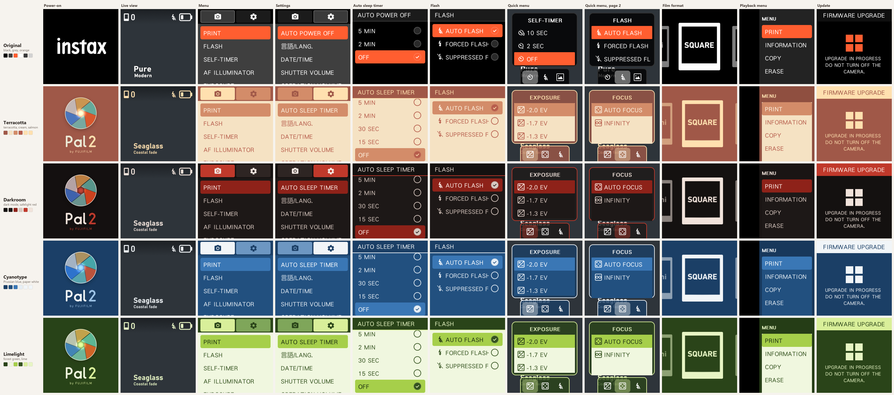
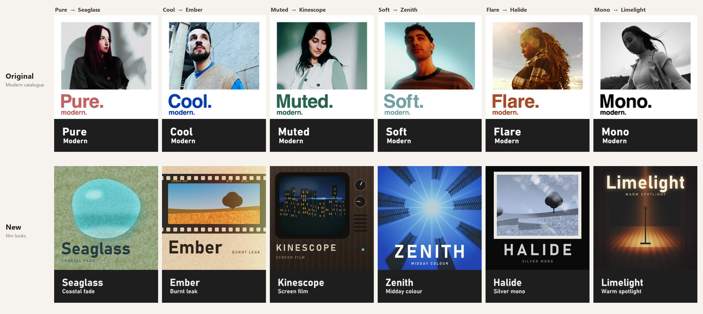

# instax Pal 2 Custom Firmware

Custom firmware for the instax Pal 2: six film looks, sharp film grain, film-camera sounds, an infinity focus mode and a
redesigned interface in four colour palettes.

## Disclaimer

This is unofficial firmware, not made or supported by Fujifilm. I have tested it on my own camera and made sure it works,
but installing it is entirely at your own discretion and risk: a failed or interrupted update can leave the camera unable to
start (bricked).

## How to install

You need the camera with a fully charged battery, a microSD card and a card reader.

1. **Back up your photos.** Copy anything you want to keep off the card and off the camera's internal memory.
2. **Optional: format the card in the camera.** This makes sure the camera detects the update. With the card in the camera,
   open the menu, go to the settings tab (gear icon), choose **FORMAT**, then **CARD**, and confirm. This erases the card.
3. **Download one palette.** From one palette folder ([below](#palettes)), download all four files:
   `SStarOta.bin.gz`, `SStarOtaLayout_ab.txt`, `OTA_VER.txt` and `downgrade.txt` (empty, but required).
   `SStarOta.bin.gz` is stored with Git LFS: open it on GitHub and use **Download raw file**, or clone the repository with
   Git LFS installed.
4. **Copy them to the card.** Put the four files in the root of the microSD card, not inside a folder, and leave no other
   firmware files on the card. Keep the file names unchanged.
5. **Start the update.** With the camera off, insert the card and turn the camera on. Open the menu, go to the settings tab,
   choose **FIRMWARE UPGRADE** and confirm with **SET**.
6. **Wait.** The screen shows UPGRADE IN PROGRESS. Do not turn the camera off or remove the card until it has finished.
   The camera removes the update files from the card by itself.

At the end the camera may show **"Version update error / Battery insufficient"**, even with a full battery. Disregard it and
turn the camera off: this message appeared on every update of this firmware, most likely because it is installed from four
files instead of the usual single update file.

To switch palette later, repeat these steps with another folder.

## Palettes

Every palette has the same features. Only the interface colours, the startup screen, the film-format cards and the look
title cards differ. The top row is the original firmware.

| Folder | Palette |
|---|---|
| [`Terracotta/`](Terracotta) | Terracotta frame, cream lists, salmon selection, peach accents |
| [`Darkroom/`](Darkroom) | Dark mode under a safelight: warm near-black, ember-red selection and tabs, warm grey text |
| [`Cyanotype/`](Cyanotype) | Prussian blue, paper-white text, a brighter blue selection |
| [`Limelight/`](Limelight) | Forest-green frame, pale lime lists, a bright lime selection with dark text |

## Looks

The six looks replace the six effects of the original Modern catalogue, slot for slot, each with its own colour, exposure,
grain and effects, and with new names, covers and title cards. The other effect catalogues are unchanged.

| Original | New look | Character | Effects |
|---|---|---|---|
| Pure | Seaglass | Coastal fade: creative colour grade | Vignette, light flare |
| Cool | Ember | Burnt leak: warm creative grade, +1/3 EV | Light leaks at 65 %, a different leak each time the look is selected |
| Muted | Kinescope | Screen film: Fujifilm X-Tra 400 | Screen texture |
| Soft | Zenith | Midday colour: Fujifilm Velvia 100, −1/3 EV | Light flare |
| Flare | Halide | Silver mono: Kodak Vision3 250D in black and white, −1/3 EV | Vignette, crystal effect, the strongest grain |
| Mono | Limelight | Warm spotlight: Kodak Portra 400, −2/3 EV | Strong vignette, glow, light leaks at 15 % |

## Changes from the original firmware

Based on the official Fujifilm firmware, build 1.0.1458. Besides the looks and palettes above:

### Image quality

- Film grain drawn at full resolution, sharp instead of blurred, for the six looks and for the original effects that use
  grain.
- JPEG quality 95 (original: 69 on the card, 48 in internal memory).
- Sharpening off.
- Luminance noise reduction at a quarter of the original strength.
- Auto exposure: metering is still centre-weighted but counts the whole frame more (about 2.4 : 1 from centre to corner
  instead of 21 : 1), with a lower exposure target in the brightest scenes.
- Bluetooth transfers: the 1280 × 960 copy is saved at a higher quality.

### Shooting

- Faster shutter response.
- Autofocus confirms focus sooner.
- Focus mode in the quick menu: AUTO FOCUS, or INFINITY, which holds the lens at infinity for instant focus on distant
  subjects and in low light. The choice is kept after power-off.
- Exposure compensation (−2 to +2 EV) in the quick menu.
- Quick menu pages: EXPOSURE, FOCUS, FLASH. Self-timer and display mode stay in the main menu.
- The saving animation also shows for the six looks.

### Interface

- Four colour palettes: menus, dialogs, quick menu, playback menu and information page, live-view icons, look title cards,
  film-format screen and firmware update screens.
- New startup screen: a six-blade aperture with "Pal 2 by FUJIFILM", in the palette's colours.
- Light text on the selected row; setting lists fill the screen.
- Smoother switching between looks.
- AUTO POWER OFF is renamed AUTO SLEEP TIMER: the camera sleeps with the screen off rather than powering down.

### Sleep timer

- Choices: 5 min, 2 min, 30 s, 15 s and off (original: 5 min, 2 min and off).
- The phone app shows 30 s and 15 s as 2 min and leaves the camera's choice unchanged.

### Sounds

- Startup: a short chime that stops as soon as another sound plays.
- Recorded from film cameras: shutter (Pentax ME Super), power off (Leica Z2X), focus confirmed (Pentax ME Super),
  OK / menu (Minolta XE-7), back (vintage SLR), direction key and dial (Zenit ET), filter dial (Minolta XG-1), print lever
  (1970s 35 mm SLR).
- Self-timer and error sounds are unchanged.

## Checksums

SHA-256 of `SStarOta.bin.gz` in each folder (all files: [SHA256SUMS.txt](SHA256SUMS.txt)):

| Palette | SHA-256 |
|---|---|
| Terracotta | `789eef7212b0ab180d7336ebf45dc9e824a6a5c98fab4bde948508c253de2392` |
| Darkroom | `9a85c4f54a04370db8f3010f4614679cfbeac21f483cfa2402f6f853aa65e7c7` |
| Cyanotype | `d5dfe3ace5007f5de442c305d577ff59f2e1bca2b5ee65bc49dbdbb3306db30c` |
| Limelight | `916a3df103989ed5f4e36bcd1c75242f1f2b8dddd16cfe5a317ef29ba71bd6ca` |

## Credits

Vibecoded in collaboration with Claude Opus 5.5 and ChatGPT Astra.
